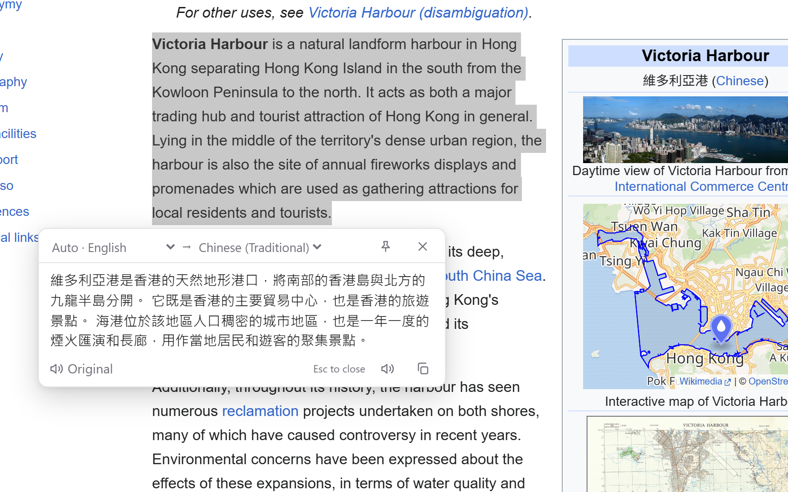
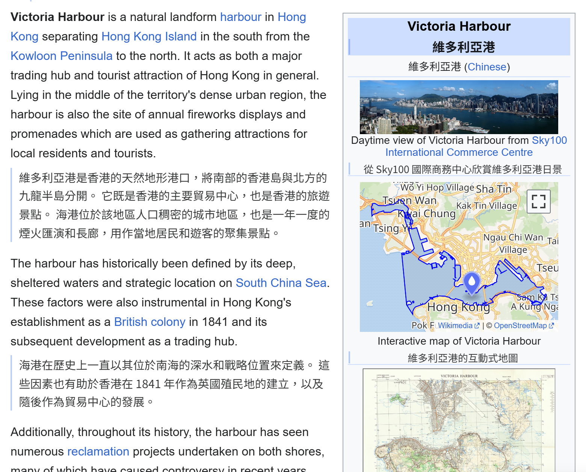
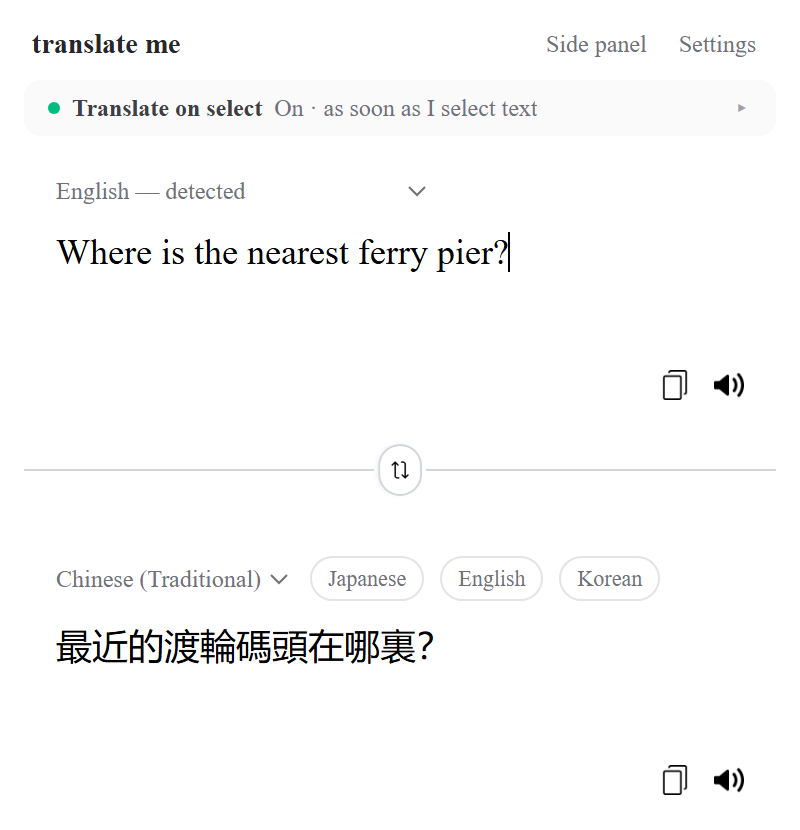
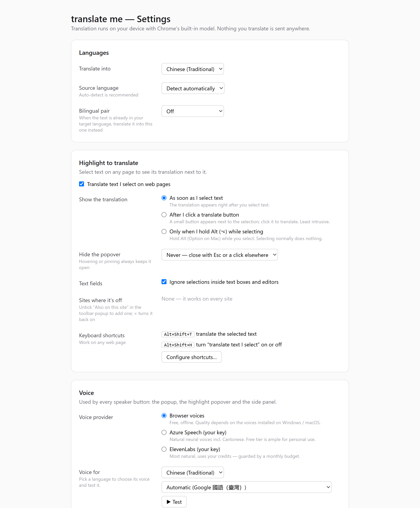

<div align="center">
  

  <h1>translate me</h1>

  <p><strong>Select any text on any page and read it in your language, instantly and privately.</strong><br>
  Powered by the AI model built into Chrome, so it's free and nothing you read leaves your computer.</p>

  <a href="https://chromewebstore.google.com/detail/translate-me/fkoepnkpnaebnedkdnljkcdchljfoadi"></a>
  <a href="./LICENSE"></a>
  <a href="https://vite.dev"></a>

  <p><a href="https://chromewebstore.google.com/detail/translate-me/fkoepnkpnaebnedkdnljkcdchljfoadi"><strong>➜ Add to Chrome — it's free</strong></a></p>
</div>



## Why translate me?

- **Free and private.** Translation runs on your computer with Chrome's built-in model. There's no account, no API key, and your text is never sent to a server.
- **Stays out of your way.** The translation card sits next to what you selected without covering it. By default it waits behind a small button; it can also appear instantly, or only while you hold <kbd>Alt</kbd>.
- **Helps you write, too.** Proofread or rewrite what you type, and look up what a word means in its sentence, with Chrome's on-device AI.
- **Gets the language right.** Japanese, Korean, Thai, and Traditional vs Simplified Chinese are recognised from their writing system. Short or ambiguous text uses the page's language and yours as hints.
- **39 languages**, including Chinese (Traditional), Japanese, Korean, Vietnamese and Ukrainian.

## Features

### Highlight to translate

Select text and the translation appears beside it. From the card you can:

- change the source or target language (your choice is remembered everywhere)
- 🔊 listen to the original or the translation
- copy the translation
- 📌 pin the card, or drag it out of the way
- close it with <kbd>Esc</kbd> or a click elsewhere

| When to show it | Best for |
| --- | --- |
| **After I click a translate button** (default) | Occasional look-ups, without interruptions |
| **As soon as I select text** | Reading in a foreign language |
| **Only when I hold Alt (⌥ on Mac)** | Pages where you select text a lot, like docs and editors |

By default a small button appears next to your selection and the card opens when you click it; switch to *As soon as I select text* in the toolbar popup if you'd rather skip the click. You can turn it off for one site, or everywhere, from the same popup. Selections inside text boxes are ignored by default.

**Bilingual pair:** set a second language, and text that's already in your target language is translated into it instead. For example, English pages become Chinese and Chinese pages become English.

### Whole-page translation

Right-click the page and choose **Translate page to …**. Each paragraph gets its translation underneath, so you can read both. Paragraphs are translated as you scroll, including content that loads later. **Show original** removes it all.



### Popup and side panel



Type or paste anything into the toolbar popup. The source language is detected for you. The chips are the languages you used most recently; click one to switch. Open the **side panel** if you want the translator to stay open while you browse.

The **Translate on select** line shows whether highlight-to-translate is on. Click it to change how it works.

<br clear="right">

### Writing tools

Proofread an email or a message before you send it, or rewrite it to sound **Friendly**, **Professional** or **Concise**. Proofread shows each change in place, so you can see what was fixed. Click **Replace** to put the suggestion into the text box (<kbd>Ctrl</kbd>+<kbd>Z</kbd> undoes it) or **Copy** to use it elsewhere.

Open the writing tools from:

- the small pen in the corner of a text box, once you've typed a few words;
- the pen button next to text you select inside a text box;
- right-click → **translate me → Improve writing**, or <kbd>Alt</kbd>+<kbd>Shift</kbd>+<kbd>W</kbd>;
- the toolbar popup, under the text you typed (**Use** puts the suggestion back in the box).

They work in English, Japanese and Spanish, and run on your computer with Gemini Nano, the AI model built into Chrome. Turn on the model, or turn off the pen in text boxes, in *Settings → On-device AI*.

### Word meanings

Select a single word or a short phrase, like *bank* or *run out of*, and the card adds what it means **in that sentence**: the part of speech, a one-word sense, a short definition and an example. A word that's already in your language gets an explanation instead of a translation. This also works in the popup, and uses the same on-device model (English, Japanese and Spanish words).

### Voices

Every 🔊 button picks the best voice installed on your computer for that language and region. For example, a Hong Kong user hears Cantonese for Traditional Chinese, and a Taiwan user hears Mandarin. You can choose a different voice per language in Settings.

For more natural voices, switch to **translate me natural voices** in *Settings → Voice*. These are free Microsoft neural voices (including Cantonese), served by the project's own voice server. Each person gets a free daily allowance; after that, the browser voice is used instead. You can also bring your own **Azure Speech** or **ElevenLabs** key. ElevenLabs gets a monthly character budget so it can't use up your credits. Audio is cached locally, so replaying is free.

### History

Text you translate with the card is kept on your computer, together with a word's meaning and example. Export it as CSV from Settings; it imports straight into Anki.

<details>
<summary><strong>Settings</strong> (screenshot)</summary>



</details>

## Getting started

1. [Install from the Chrome Web Store](https://chromewebstore.google.com/detail/translate-me/fkoepnkpnaebnedkdnljkcdchljfoadi). You need **desktop Chrome 138 or newer** on Windows, macOS, Linux or ChromeOS.
2. Reload any tabs that were already open.
3. Select some text and click the small button next to it. The first time you use a language pair, Chrome downloads its model once. If the card shows a **Download** button, click it to start.

| Shortcut | Action |
| --- | --- |
| <kbd>Alt</kbd>+<kbd>Shift</kbd>+<kbd>T</kbd> | Translate the selected text |
| <kbd>Alt</kbd>+<kbd>Shift</kbd>+<kbd>H</kbd> | Turn highlight-to-translate on or off |
| <kbd>Alt</kbd>+<kbd>Shift</kbd>+<kbd>W</kbd> | Open the writing tools for the text box you're typing in |
| <kbd>Esc</kbd> | Close the translation card |

Change shortcuts at `chrome://extensions/shortcuts`. If another app already uses a shortcut, Chrome leaves it unset.

<details>
<summary><strong>Supported languages</strong></summary>

Arabic, Bangla, Bulgarian, Chinese (Simplified), Chinese (Traditional), Croatian, Czech, Danish, Dutch, English, Finnish, French, German, Greek, Hebrew, Hindi, Hungarian, Indonesian, Italian, Japanese, Kannada, Korean, Lithuanian, Marathi, Norwegian, Polish, Portuguese, Romanian, Russian, Slovak, Slovenian, Spanish, Swedish, Tamil, Telugu, Thai, Turkish, Ukrainian, Vietnamese.

This is the list Chrome's built-in translator supports.
</details>

<details>
<summary><strong>Troubleshooting</strong></summary>

- **Nothing happens when I select text.**
  - By default a small translate button appears first: click it. To skip the click, choose *As soon as I select text* in the popup.
  - Check the *Translate on select* line in the popup: it may be off, set to *Alt* mode, or turned off for this site.
  - Tabs opened before installing or updating need a reload.
  - Chrome doesn't let extensions run on `chrome://` pages, the Web Store or the built-in PDF viewer.
- **"Chrome's built-in translator isn't available."** You need desktop Chrome 138+. The built-in AI isn't available on mobile.
- **No writing tools or word meanings.** Open *Settings → On-device AI*. If the model isn't downloaded yet, click **Download**; if your computer can't run it, that line says so. Both work for English, Japanese and Spanish text.
- **"This embedded frame doesn't allow Chrome's translator."** Some sites embed content from another site in a frame that blocks the translator. Open that content in its own tab.
- **The voice sounds robotic, or is the wrong accent.**
  - Pick a different voice in *Settings → Voice*.
  - Install more voices: on Windows in *Settings → Time & language → Speech*; on macOS in *System Settings → Accessibility → Spoken Content*.
  - Or connect Azure Speech.
</details>

## Privacy

- **On-device translation.** Text is translated, and its language detected, by Chrome's built-in models on your computer. It isn't sent anywhere.
- **On-device writing tools and word meanings.** Text you proofread or rewrite, and words you look up, are handled by Gemini Nano on your computer. Chrome downloads the model only when you click **Download** in Settings.
- **No personal data.** No analytics, and no IP addresses, browsing history or identifiers are collected.
- **Your data stays local.** Settings sync through your Chrome profile. Translation history and API keys stay on this device and are removed with the extension.
- **Optional natural voices.** Only if you turn on *translate me natural voices*: the text you choose to listen to is sent to the translate me voice server and Microsoft Azure to make the audio. The server keeps the audio in a cache, but never logs the text or your IP address ([how it works](server/tts-proxy/README.md)).
- **Optional cloud voices with your own key.** Only if you add your own Azure or ElevenLabs key: the text you choose to listen to is sent to that provider to make the audio. The extension asks for network access to the provider only when you connect it.
- **Open page in Google Translate.** This menu item sends the page's address to Google, the same as visiting Google Translate yourself.

Full policy: [translateme-privacy.netlify.app](https://translateme-privacy.netlify.app/)

## Development

```bash
pnpm install
pnpm test     # extension unit tests (vitest) + voice server tests (node --test)
pnpm build    # builds the unpacked extension into dist/
```

Load `dist/` at `chrome://extensions` → *Developer mode* → *Load unpacked*. After rebuilding, click ↻ on the extension card and reload your tabs.

| Path | What's there |
| --- | --- |
| `src/core/` | Language detection, translation, settings and voice ranking, shared by every part of the extension |
| `src/content/` | The highlight card, its placement, and page translation (runs inside web pages) |
| `src/background/` | Service worker: context menus, shortcuts, and speech (browser, Azure, ElevenLabs) |
| `src/component/`, `src/options/` | Popup / side panel and settings page (React) |
| `tests/` | Unit tests |
| `server/tts-proxy/` | The shared voice server ([deploy guide](server/tts-proxy/README.md)) |

Merging to `main` releases automatically: version bump, changelog, GitHub release, and Chrome Web Store submission. See [docs/PUBLISHING.md](docs/PUBLISHING.md) for the one-time store setup.

## Support

Questions or ideas? [Open an issue](https://github.com/amsyeung/translate-me/issues) or email info@aoricreative.com.

If translate me is useful to you, you can [buy me a coffee ☕](https://buymeacoffee.com/amsy). It keeps the project maintained and free for everyone.

Licensed under [GPLv3](./LICENSE).
