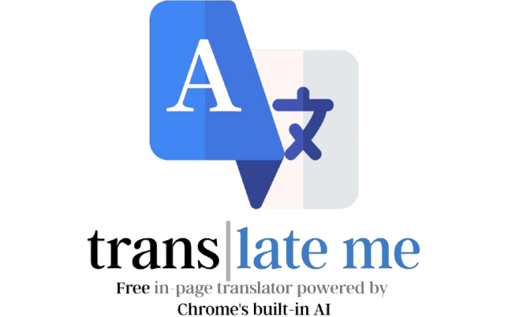
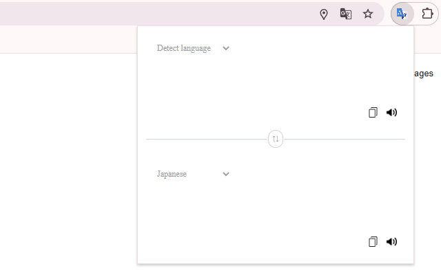
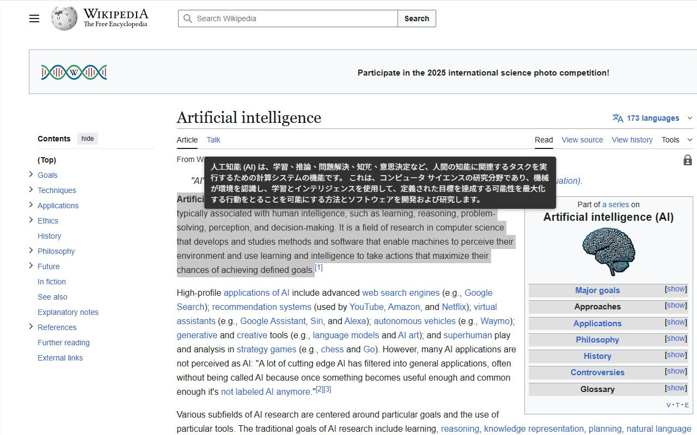
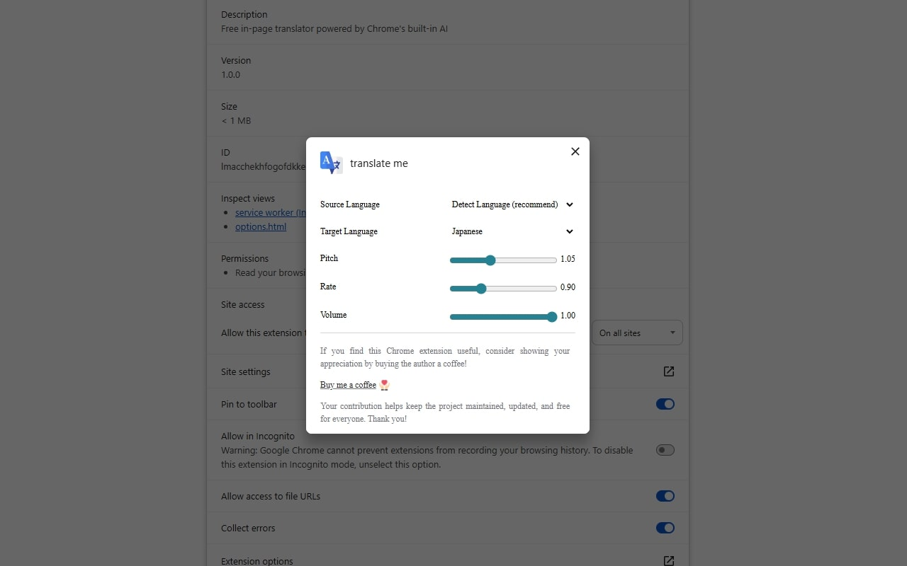

# translate me

<div align="center">
  <picture>
    
  </picture>
  
  <a href="https://vite.dev"></a>
  <a href="./LICENSE"></a>  

  [View Chrome Extension](https://chromewebstore.google.com/detail/translate-me/fkoepnkpnaebnedkdnljkcdchljfoadi)

</div>

# ⚙️ Features

- **Highlight to translate** – select text on any page and the translation appears in a card next to it. The card never covers the text you selected and stays on screen at the window edges. You can switch the source or target language right in the card, listen to the original or the translation, copy it, pin the card, or drag it out of the way.
  - Three trigger modes: *show instantly*, *show a button first*, or *only while holding Alt / ⌥ Option*.
  - Turn it off per site or everywhere from the toolbar popup, or with a keyboard shortcut.
  - **Bilingual pair**: text that is already in your target language is translated into your second language instead.
- **Accurate language detection** – detects by writing system first (Japanese kana, Korean, Thai, Traditional vs Simplified Chinese…), then Chrome's on-device detector with a confidence threshold, using the page language and your browser languages to resolve short, ambiguous text.
- **Popup and side panel translator** – with quick-switch chips for recently used languages.
- **Whole-page translation** – right-click → *Translate page*: each paragraph gets its translation underneath, on-device, including content that loads later.
- **Voices** – the best installed voice is picked per language and region (e.g. Cantonese for Hong Kong users), and you can choose your own in Settings. Optionally bring your own **Azure Speech** or **ElevenLabs** key for natural neural voices, with a monthly character budget and a local audio cache.
- **History** – highlight translations are kept locally and can be exported as CSV (imports into Anki).

Requires desktop Chrome 138 or newer (Windows, macOS, Linux, ChromeOS).

<details>
<summary>pop-up translate</summary>



</details>

<details>
<summary>translate selected text</summary>



</details>

<details>
<summary>settings control</summary>


</details>

## ⌨️ Shortcuts

| Shortcut | Action |
| --- | --- |
| <kbd>Alt</kbd>+<kbd>Shift</kbd>+<kbd>T</kbd> | Translate the selected text |
| <kbd>Alt</kbd>+<kbd>Shift</kbd>+<kbd>H</kbd> | Turn highlight-to-translate on/off |
| <kbd>Esc</kbd> | Close the translation card |

Change them at `chrome://extensions/shortcuts`.

## 📄 Privacy & Security

- **On-device translation** – text is translated and its language detected by Chrome's built-in models on your computer. It is not sent to any server.
- **No personal data** – IP addresses, browsing history, or identifiers are never collected.
- **Local storage only** – settings sync through your Chrome profile (`chrome.storage.sync`); translation history and API keys stay on this device (`chrome.storage.local`) and are removed with the extension.
- **Optional cloud voices** – only if you add your own Azure or ElevenLabs key: the text you choose to listen to is sent to that provider to generate audio. The extension asks for network access to that provider only when you connect it.
- **Google Translate page link** – the *Open page in Google Translate* menu item sends the page URL to Google, as visiting Google Translate would.

See full policy [here](https://translateme-privacy.netlify.app/)

## 🛠 Development

```bash
pnpm install
pnpm test    # unit tests (vitest)
pnpm build   # outputs the unpacked extension to dist/
```

Load `dist/` via `chrome://extensions` → *Developer mode* → *Load unpacked*.

Releases are automatic on merge to `main` (version bump, changelog, GitHub release, Chrome Web Store submission). See [docs/PUBLISHING.md](docs/PUBLISHING.md) for the one-time store setup.

## 📬 Support & Feedback

Got questions or want a new feature?

Open an issue on GitHub or email me at yeung.ming.sang@gmail.com

## 🎉 Thanks for using Translate‑Me!

Happy translating! 🚀
